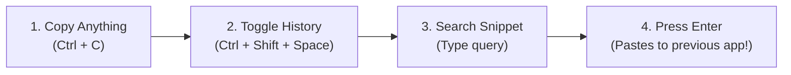
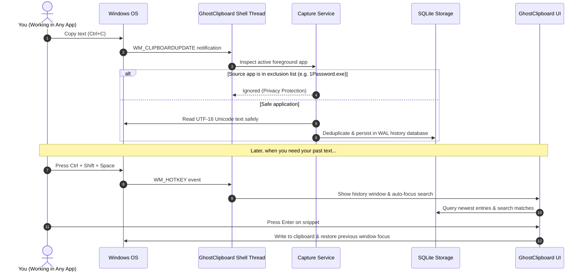
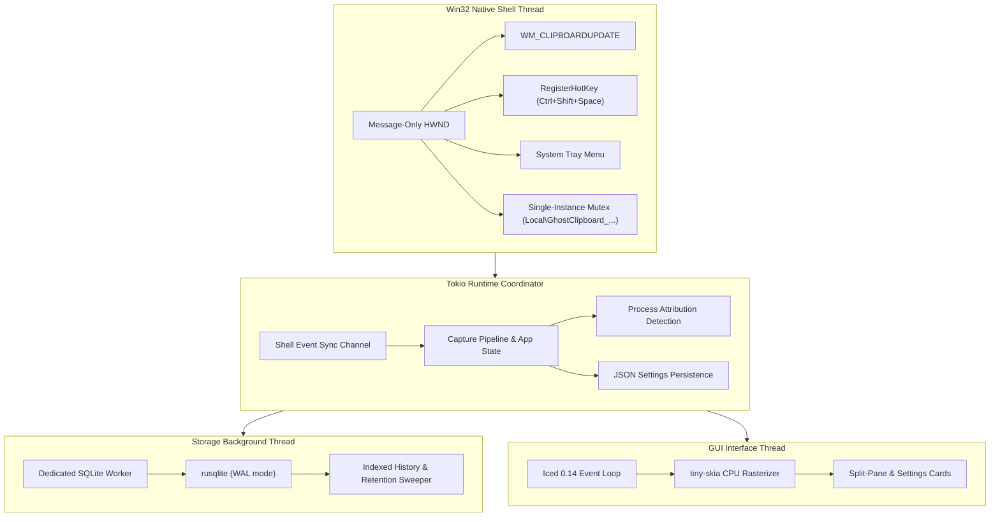

# 👻 GhostClipboard

[](https://microsoft.com)
[](https://www.rust-lang.org)
[](https://iced.rs)
[](https://sqlite.org)
[](LICENSE)

> A blazing fast, keyboard-first, native Windows 11 clipboard manager built in Rust. It stays quietly in your background, captures your copied snippets without slowing down your computer, and lets you paste past items in a fraction of a second.

---

## 💡 Why GhostClipboard?

Most modern clipboard utilities are heavy web wrappers or cloud-connected apps that track your data or consume hundreds of megabytes of RAM.

GhostClipboard takes a strictly native, privacy-first approach:

* **⚡ Ultra Lightweight:** Compiled native Rust desktop binary using a fast CPU rasterizer (`tiny-skia`). Idle RAM usage is only ~25–35 MB, with zero GPU driver dependencies.
* **🛡️ 100% Offline & Private:** No cloud sync, no tracking, no analytics, and no open internet sockets. Your passwords and copied snippets never leave your computer.
* **⌨️ Keyboard-Centric Speed:** Press `Ctrl+Shift+Space`, type to fuzzy-search, press `Enter`, and it instantly copies the snippet and returns focus to your previous app so you can paste right away.
* **🔒 Password Manager Aware:** Automatically ignores copies originating from KeePass, 1Password, Bitwarden, and other sensitive applications.
* **🔄 Zero Polling:** Listens purely to native Windows clipboard events (`WM_CLIPBOARDUPDATE`), leaving your CPU at 0% when idle.

---

## 🚀 Quick Start in 10 Seconds



1. **Launch:** Run `ghostclipboard.exe`. GhostClipboard runs in your system tray.
2. **Copy Normally:** Use Windows as you normally do (`Ctrl+C` text, links, code).
3. **Bring Up History:** Press <kbd>Ctrl</kbd> + <kbd>Shift</kbd> + <kbd>Space</kbd> anywhere in Windows.
4. **Select & Paste:** Use <kbd>↑</kbd> / <kbd>↓</kbd> to pick an entry (or type to search), then hit <kbd>Enter</kbd>.
   * GhostClipboard copies the selected text, closes the window, and automatically restores focus to your active window.

---

## 🎯 How It Works Under the Hood

Here is how GhostClipboard processes your clipboard events smoothly in the background:



---

## ⌨️ Keyboard Shortcuts Reference

Designed so you never have to take your hands off the keyboard:

| Shortcut | Action |
| :--- | :--- |
| <kbd>Ctrl</kbd> + <kbd>Shift</kbd> + <kbd>Space</kbd> | **Toggle History Window** anywhere in Windows |
| <kbd>↑</kbd> / <kbd>↓</kbd> (Up / Down) | **Navigate** through results or history entries |
| <kbd>Enter</kbd> | **Copy & Return** to previous active window |
| <kbd>Esc</kbd> | **Dismiss** history window (clears search first if typing) |
| <kbd>Ctrl</kbd> + <kbd>P</kbd> | **Pin / Unpin** selected snippet (pinned entries never expire) |
| <kbd>Delete</kbd> or <kbd>Ctrl</kbd> + <kbd>D</kbd> | **Permanently delete** selected snippet |

---

## 🛡️ Privacy & Security Details

> [!IMPORTANT]
> **Zero Cloud Sync & Zero Telemetry:** GhostClipboard contains no networking code. No telemetry packets, crash reports, or clipboard contents are ever transmitted over the network.

* **Where is data stored?**
  * SQLite History Database: `%APPDATA%\GhostClipboard\history.db`
  * User Configuration: `%APPDATA%\GhostClipboard\settings.json`
* **Password Manager Shield:**
  * By default, processes named `1Password.exe`, `KeePass.exe`, `Bitwarden.exe`, `KeePassXC.exe`, `Enpass.exe`, `LastPass.exe`, and `Dashlane.exe` are completely excluded.
  * You can add any custom executable (e.g. `secret_app.exe`) directly in the Settings tab.
* **Log Sanitization:**
  * All diagnostic logs record strictly operational metrics (e.g. entry count, character count, deduplication status). **Clipboard text is never printed to logs or terminal output.**

---

## ⚙️ Settings & Customization

GhostClipboard includes a built-in Settings tab right inside the interface:

* **Maximum Entry Size:** Choose between 512 KB, 1 MB, 2 MB, 5 MB, or 10 MB to prevent gigantic copy operations from eating up memory.
* **Deduplication Mode:**
  * *Move to Top:* Copying an item already in history moves it back to the top without creating duplicate clutter.
  * *Consecutive Only:* Only merges duplicate copies if they occur back-to-back.
* **History Retention:**
  * Limit unpinned entries to 200, 500, 1,000, 5,000, or unlimited.
  * Limit entry age to 7 days, 30 days, 90 days, 1 year, or keep forever.
  * Pinned entries (`Ctrl+P`) are always preserved.
* **Launch at Windows Login:** Toggle automatic startup with a single click (registers in `HKCU\Software\Microsoft\Windows\CurrentVersion\Run` with `--background`).

---

## 🏗️ System Architecture

For engineers interested in the internal concurrency design:



* Read the complete [Architecture Documentation](docs/ARCHITECTURE.md) for detailed Win32 API contracts, error recovery, and database schema diagrams.

---

## 📦 Building from Source

### Prerequisites

* Windows 11 (64-bit)
* [Rust Stable](https://rustup.rs/) (1.80+):
  ```powershell
  rustup default stable-x86_64-pc-windows-msvc
  ```

### Build & Run

```powershell
# Clone the repository
git clone https://github.com/Yuuji/ghost-clipboard.git
cd ghost-clipboard

# Run test suite (53 unit & integration tests)
cargo test

# Build optimized release binary
cargo build --release
```

The resulting standalone executable is generated at:
```powershell
target\release\ghostclipboard.exe
```

> [!TIP]
> The release executable is configured as a native Windows GUI subsystem binary (`windows_subsystem = "windows"`), meaning it launches silently without showing any command prompt window.

---

## ❓ Frequently Asked Questions (FAQ)

<details>
<summary><b>Does GhostClipboard support copying images or file paths?</b></summary>
GhostClipboard's initial version is deliberately focused on high-speed plain text, URLs, formatted code snippets, and multiline Unicode data. Non-text formats are safely ignored without errors.
</details>

<details>
<summary><b>How do I close the application completely?</b></summary>
Right-click the GhostClipboard tray icon in the Windows taskbar corner and click <b>Exit</b>.
</details>

<details>
<summary><b>What happens if another app locks the clipboard?</b></summary>
GhostClipboard uses a bounded exponential retry mechanism (up to 4 quick attempts) rather than crashing or freezing your computer.
</details>

<details>
<summary><b>Can I run multiple copies of GhostClipboard?</b></summary>
GhostClipboard enforces a single-instance safeguard using a named Windows Mutex. If you try to run the application again, it signals the existing background instance to bring its window forward and immediately exits.
</details>

---

## 📜 License

This project is licensed under the **MIT License**. See the [LICENSE](LICENSE) file for details.
