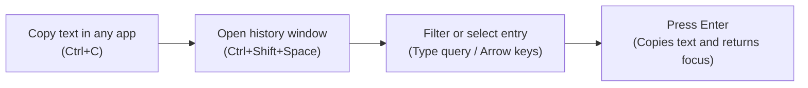
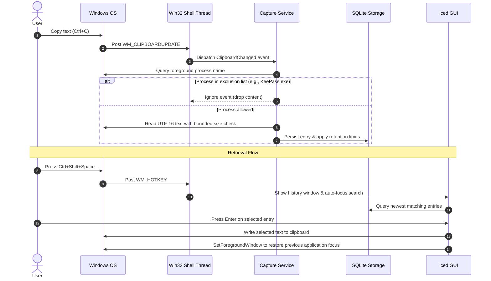
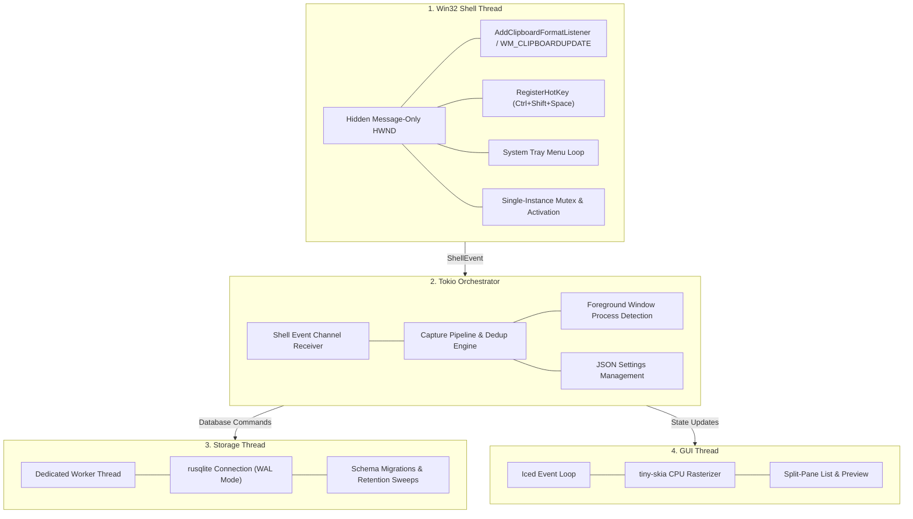

# GhostClipboard

[](https://microsoft.com)
[](https://www.rust-lang.org)
[](https://iced.rs)
[-4682b4.svg)](https://sqlite.org)
[](LICENSE)

GhostClipboard is a native Windows 11 clipboard history manager written in Rust. It runs as a background service, captures clipboard text via native Windows event notifications, stores history in an embedded SQLite database, and provides a keyboard-driven interface to retrieve previously copied entries.

---

## Overview

GhostClipboard is designed as a focused, lightweight desktop utility rather than a web-wrapper or cloud service.

* **Native Windows Event Loop:** Uses `AddClipboardFormatListener` and `WM_CLIPBOARDUPDATE`. It does not poll the clipboard.
* **Low Resource Usage:** Uses Iced with a software CPU rasterizer (`tiny-skia`). Idle memory usage remains around 25–35 MB, avoiding GPU context overhead and graphics driver conflicts.
* **Keyboard-First Workflow:** Press `Ctrl+Shift+Space` to bring up the search interface, navigate with arrow keys, and press `Enter` to copy and restore focus to your previous application.
* **Local-Only Storage:** All data resides in a local SQLite database in WAL mode. There is no telemetry, cloud synchronization, or network connectivity.
* **Process Attribution & Exclusions:** Identifies the active foreground process when clipboard content changes and drops events originating from password managers (such as KeePass, 1Password, and Bitwarden) or custom excluded applications.

---

## User Interaction Flow



---

## Event and Data Flow

The following sequence details how clipboard changes and history retrieval are handled across the system components:



---

## System Architecture

GhostClipboard separates operating system message handling, asynchronous orchestration, persistence, and interface rendering into distinct threads:



For comprehensive details regarding Win32 API interactions, locking strategies, and schema definitions, refer to [docs/ARCHITECTURE.md](docs/ARCHITECTURE.md).

---

## Keyboard Shortcuts

| Shortcut | Description |
| :--- | :--- |
| `Ctrl + Shift + Space` | Global hotkey to open or dismiss the history window from any application. |
| `Arrow Up` / `Arrow Down` | Select previous / next entry in the list. |
| `Enter` | Copy the selected entry to the clipboard, close the window, and restore focus to the previous application. |
| `Escape` | Close the history window. If a search query is active, clears the search input first. |
| `Ctrl + P` | Pin or unpin the selected entry. Pinned entries are excluded from retention pruning. |
| `Delete` or `Ctrl + D` | Permanently delete the selected entry from history. |

---

## Privacy and Storage

* **Data Storage Locations:**
  * SQLite Database: `%APPDATA%\GhostClipboard\history.db`
  * Settings File: `%APPDATA%\GhostClipboard\settings.json`
* **Network Isolation:** GhostClipboard contains no networking code or telemetry libraries. All processing and persistence are strictly local.
* **Log Sanitization:** Diagnostic logging configured via `tracing` records execution flow, character lengths, and error statuses. Raw clipboard text and preview strings are never output to logs or terminal streams.
* **Process Exclusion:**
  * Default exclusions: `1Password.exe`, `KeePass.exe`, `Bitwarden.exe`, `KeePassXC.exe`, `Enpass.exe`, `LastPass.exe`, and `Dashlane.exe`.
  * Custom executable names can be added or removed in the Settings panel.
  * *Note on attribution:* Process identification checks the active foreground window at notification time (`GetForegroundWindow`). Extremely rapid application switching during a copy operation may occasionally attribute the copy to the incoming foreground window.

---

## Configuration

Settings can be managed through the built-in Settings tab and are persisted to `%APPDATA%\GhostClipboard\settings.json`:

* **Maximum Entry Size:** Selectable threshold (512 KB, 1 MB, 2 MB, 5 MB, or 10 MB). Entries exceeding this limit are ignored to prevent excessive memory consumption.
* **Deduplication Mode:**
  * `Anywhere`: Copies matching an existing entry update its timestamp and move it to the top.
  * `Latest Only`: Only deduplicates if the new copy is identical to the most recent entry.
* **Retention Limits:**
  * Max unpinned entries: 200, 500, 1,000, 5,000, or unlimited.
  * Max age: 7 days, 30 days, 90 days, 1 year, or keep forever.
* **Autostart:** Toggle launch-at-login (`HKCU\Software\Microsoft\Windows\CurrentVersion\Run`) with the `--background` flag.

---

## Building from Source

### Prerequisites

* Windows 11 (64-bit)
* Rust toolchain (stable 1.80 or newer with MSVC target):
  ```powershell
  rustup default stable-x86_64-pc-windows-msvc
  ```

### Build Commands

```powershell
# Clone the repository
git clone https://github.com/Yuuji/ghost-clipboard.git
cd ghost-clipboard

# Run test suite
cargo test

# Build optimized release binary
cargo build --release
```

The compiled executable is placed at `target\release\ghostclipboard.exe`.

In release mode, the binary is compiled with `#![cfg_attr(not(debug_assertions), windows_subsystem = "windows")]`, ensuring it runs as a pure GUI subsystem process without spawning a console window.

---

## License

This project is licensed under the [MIT License](LICENSE).
