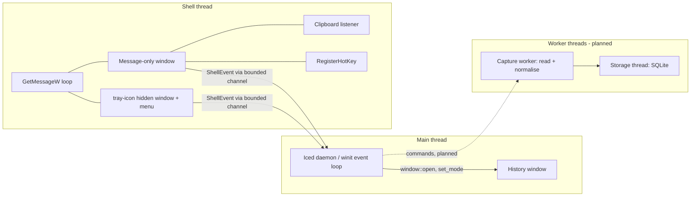

# GhostClipboard architecture

Status: Phase 1 (foundation). Sections marked **planned** describe the agreed
design for later phases and are not implemented yet.

## Goals and constraints

- Windows 11 x64, stable Rust, Iced GUI, local-only storage, no telemetry.
- A background utility: idle CPU should be ~0, memory modest, nothing blocks the UI thread.
- Windows-specific code is isolated in `platform::windows`; domain logic (history rules,
  deduplication, retention, settings, exclusion matching) stays platform-neutral and unit-testable.

## Verified stack

Versions were checked against crates.io and the crate sources at the start of Phase 1.

| Concern | Choice | Notes |
| --- | --- | --- |
| GUI | `iced` 0.14.0 (`iced_winit` 0.14.1, `winit` 0.30.13) | Latest stable. `iced::daemon` keeps the process alive without windows. |
| Renderer | `tiny-skia` (CPU) | No GPU context: lower idle memory and no driver dependence for a text-only list. `wgpu` is disabled. |
| Tray | `tray-icon` 0.26.1 (MSRV 1.90) | Needs a Win32 message loop on the creating thread. |
| Global shortcut | Native `RegisterHotKey` via `windows` 0.62 | See decision 3. |
| Clipboard notifications | `AddClipboardFormatListener` / `WM_CLIPBOARDUPDATE` via `windows` 0.62 | Event driven, no polling. |
| Persistence | `rusqlite` 0.40.2 (bundled, functions) | SQLite with WAL mode, normal synchronous, auto-vacuum, migrations |
| Diagnostics | `tracing` | Never logs clipboard content. |

The crate's `rust-version` is 1.90 (driven by `tray-icon`); the toolchain used is 1.98.1.

## Process and thread model



- The **shell thread** owns every Win32 object that needs a message loop. It blocks in
  `GetMessageW` while idle.
- The **Iced event loop** stays on the main thread. Shell events reach it through an Iced
  `Subscription` that awaits a bounded `tokio::sync::mpsc` receiver.
- Shell → app traffic uses `try_send` on a 64-slot channel: the window procedure must never
  block, and a burst of notifications must not grow memory. Dropped notifications are counted and
  reported as `ShellEvent::Overflow` on the next successful delivery.
- `ShellEvent` carries **no clipboard content**. A clipboard notification is only a signal;
  reading the data is a separate fallible step done off the UI thread (Phase 2).

## Module layout

```
src/
  main.rs                    entry point, logging, start-up options
  lib.rs
  branding.rs                procedurally drawn icon (tray + window)
  app/                       Iced state, messages, view, subscriptions
  platform/
    mod.rs                   platform-neutral vocabulary: ShellEvent, Hotkey, faults
    windows/
      shell.rs               shell thread: message loop, listener, hotkey, tray
```

Planned additions: `domain/` (entries, filtering, retention, settings), `services/` (capture
orchestration, history operations), `storage/` (SQLite, migrations), `platform/windows/clipboard.rs`
(read/write), `platform/windows/foreground.rs` (foreground app metadata, focus restore),
`platform/windows/startup.rs` (launch at login).

## Decisions

1. **Dedicated shell thread instead of piggy-backing on winit's loop.** Win32 delivers
   clipboard, hotkey and tray messages to the thread that created the window. winit's loop would
   pump those messages incidentally, which ties them to the GUI's lifetime. An explicit loop on a
   separate thread keeps them independent and lets the GUI window be hidden or recreated freely.
2. **`iced::daemon` + hide/show via `window::set_mode`.** The daemon keeps running with zero
   windows (needed for `--background` start). Closing the window is intercepted
   (`exit_on_close_request: false`) and turns into `Mode::Hidden`; showing restores `Mode::Windowed`
   and requests focus. Verified: hide/show cycles work and the process stays alive. Trade-off: the
   hidden window keeps its (small, CPU-rendered) surface; recreate-on-open can be revisited if
   measurements justify it.
3. **Native `RegisterHotKey` instead of the `global-hotkey` crate.** We already own a message loop
   and window, so registration is ~30 lines. `global-hotkey` 0.8 would add a second hidden window,
   process-global event-handler statics, and a polling thread per key press (to detect release) that
   we do not need. Native registration also reports `ERROR_HOTKEY_ALREADY_REGISTERED`, which we
   turn into a user-facing conflict message. `MOD_NOREPEAT` prevents repeated toggling while the keys
   are held.
4. **Message-only window for clipboard and hotkey messages.** It never shows in the taskbar,
   Alt+Tab or window enumeration.
5. **Non-fatal component faults.** Clipboard listener, hotkey and tray failures are reported as
   `ShellFault`s rather than aborting start-up, so the app can run degraded and tell the user why.
6. **No content in diagnostics.** Logs record event kinds and counts only.

## Findings from the Phase 1 spikes

- `Set-Clipboard` from PowerShell produced **three** `WM_CLIPBOARDUPDATE` messages per copy
  (clear, set, and a follow-up). The capture pipeline therefore **must** coalesce notifications
  and compare `GetClipboardSequenceNumber()` before reading, in addition to content deduplication.
- `tray-icon` silently keeps a tray window alive even if the shell is not ready, and re-adds the
  icon on `TaskbarCreated` (Explorer restart). It drops click events if `Shell_NotifyIconGetRect`
  fails, so click handling depends on the icon being genuinely registered.
- `RegisterHotKey` conflicts are detectable at registration time (covered by a test).

## Known limitations (Phase 1)

- The Phase 1 window is an integration check, not the real UI.
- Pause/Settings tray items are placeholders until later phases.
- Real keyboard activation of the shortcut and the visual presence of the tray icon could not be
  verified in the development sandbox. See [VALIDATION.md](VALIDATION.md).

