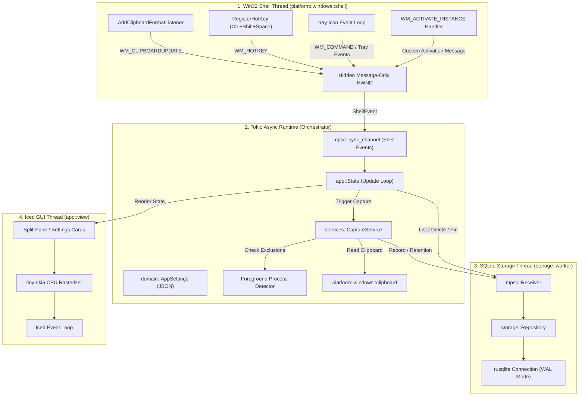

# GhostClipboard Architecture Documentation

## 1. Overview & System Philosophy

GhostClipboard is a native Windows 11 clipboard history manager designed around four core tenets:

1. **Lightweight & Native:** Minimal memory and CPU consumption. GhostClipboard is a compiled native Rust binary that consumes ~25-35 MB RAM when idle, utilizing a CPU rasterizer (`tiny-skia`) instead of heavyweight web runtimes or large graphics frameworks.
2. **Event-Driven Integration:** Never polls the clipboard in a loop. Integrates directly with the Windows message pump via `AddClipboardFormatListener` and `WM_CLIPBOARDUPDATE`.
3. **Strict Local Privacy:** Operates 100% offline. Zero telemetry, zero analytics, zero network sockets, and zero sensitive clipboard text written to diagnostic logs.
4. **Keyboard-First Ergonomics:** Designed for high-speed operation with minimal friction: instant search focus, arrow key navigation, Enter to copy and restore previous window focus, and Escape to dismiss.

---

## 2. Multi-Threaded Process Model

The application isolates responsibilities across distinct operating system threads and an asynchronous coordination runtime:



---

## 3. Component Deep Dive

### 3.1 Win32 Shell Layer (`platform::windows::shell`)

* **Message-Only Window:** Spawns a dedicated thread that registers a Win32 window class and creates a message-only window (`CreateWindowExW(..., HWND_MESSAGE, ...)`).
* **Clipboard Notification:** Calls `AddClipboardFormatListener(hwnd)` upon creation and `RemoveClipboardFormatListener(hwnd)` upon shutdown. Windows posts `WM_CLIPBOARDUPDATE` to this window whenever any process writes to the clipboard.
* **Global Hotkey:** Calls `RegisterHotKey(hwnd, 1, MOD_CONTROL | MOD_SHIFT | MOD_NOREPEAT, VK_SPACE)`. When triggered, `WM_HOTKEY` is translated into `ShellEvent::HotkeyPressed`.
* **System Tray:** Integrates with `tray-icon` to install a notification icon and context menu. The menu handles:
  * `Open History`: Displays and focuses the main window.
  * `Toggle Pause`: Pauses/resumes clipboard capture.
  * `Open Settings`: Displays the settings tab.
  * `Exit`: Shuts down the background service and terminates cleanly.
* **Bounded Channel:** Translates Win32 messages into `ShellEvent` enums sent over a bounded `sync_channel(64)` with overflow tracking (`ShellEvent::Overflow`) to prevent memory exhaustion during event bursts.

### 3.2 Win32 Clipboard Access (`platform::windows::clipboard`)

* **Locking & Retries:** When another application holds the clipboard open, calling `OpenClipboard` immediately fails with `ERROR_ACCESS_DENIED`. GhostClipboard employs a bounded exponential retry strategy (up to 4 attempts with short 10ms-30ms delays) rather than a busy loop.
* **Format Inspection:** Verifies `IsClipboardFormatAvailable(CF_UNICODETEXT)`. Non-text formats (images, audio, custom binaries) are cleanly ignored in the text pipeline without errors.
* **Bounded Memory Buffer:** Calls `GlobalLock` on the returned `HGLOBAL`, measures buffer size using `GlobalSize`, and rejects content exceeding the configured maximum entry size (default 1 MB, configurable up to 10 MB) *before* decoding into Rust UTF-8 `String`.
* **Verbatim Preservation:** Whitespace, tabs, and Windows `\r\n` CRLF carriage returns are preserved verbatim without destructive sanitization.

### 3.3 Process Attribution & Exclusion (`platform::windows::foreground`)

* **Detection Flow:**
  1. `GetClipboardOwner()` retrieves the owning window of the current clipboard content, avoiding race conditions during fast window transitions. If unowned or invalid, falls back to `GetForegroundWindow()`.
  2. `GetWindowThreadProcessId()` retrieves the owning process ID (`PID`).
  3. `OpenProcess(PROCESS_QUERY_LIMITED_INFORMATION)` opens the process with minimal privileges (no administrator rights needed).
  4. `QueryFullProcessImageNameW()` retrieves the absolute path of the executable.
  5. The executable filename is extracted (e.g. `KeePass.exe`) and compared against the exclusion list.
* **Default Exclusions:** Pre-configured with major password managers:
  * `1Password.exe`, `1Password7.exe`, `KeePass.exe`, `KeePassXC.exe`, `Bitwarden.exe`, `Enpass.exe`, `Dashlane.exe`, `NordPass.exe`, `RoboForm.exe`, `LastPass.exe`.
* **Timing Disclaimer:** Because process attribution is queried at notification receipt, an instantaneous window switch concurrently with an unowned copy event may occasionally attribute the copy to the newly focused window. This known OS behavior is clearly disclosed in documentation and user settings.

### 3.4 Single-Instance Safeguard (`platform::windows::single_instance`)

* **Named Mutex:** On startup, `main()` attempts to acquire a named Windows mutex: `Local\GhostClipboard_SingleInstance_Mutex`.
* **Secondary Instance Handling:** If `GetLastError() == ERROR_ALREADY_EXISTS`:
  1. The new process searches for the existing background shell window using `FindWindowExW(Some(HWND_MESSAGE), None, w!("GhostClipboardShell"), None)`.
  2. It posts `WM_ACTIVATE_INSTANCE` (`WM_APP + 2`) to the existing shell window.
  3. The existing process activates its Iced window and brings it to the foreground.
  4. The second instance exits with code `0`.

### 3.5 SQLite Persistence Engine (`storage`)

* **Storage Worker Thread:** A dedicated OS thread owns the `rusqlite::Connection` to ensure no database I/O ever stalls the Iced GUI thread.
* **WAL Mode:** On startup, the connection sets:
  ```sql
  PRAGMA journal_mode = WAL;
  PRAGMA synchronous = NORMAL;
  PRAGMA foreign_keys = ON;
  PRAGMA busy_timeout = 3000;
  PRAGMA secure_delete = ON;
  ```
* **Schema Migration:** Database migrations are versioned via `PRAGMA user_version`:
  * **Version 1:** Creates table `entries` with columns:
    * `id`: `INTEGER PRIMARY KEY AUTOINCREMENT`
    * `text`: `TEXT NOT NULL` (verbatim clipboard text)
    * `preview`: `TEXT NOT NULL` (first 400 characters, truncated on unicode grapheme cluster boundaries)
    * `char_count`: `INTEGER NOT NULL`
    * `content_type`: `TEXT NOT NULL` (`text`, `url`)
    * `hash`: `BLOB NOT NULL` (SHA-256 byte array)
    * `copied_at`: `INTEGER NOT NULL` (epoch milliseconds)
    * `pinned`: `INTEGER NOT NULL DEFAULT 0 CHECK (pinned IN (0, 1))`
    * `source_app`: `TEXT` (executable name)
  * **Indexes:**
    * `idx_entries_copied_at` on `entries (copied_at DESC, id DESC)`
    * `idx_entries_hash` on `entries (hash)`
    * `idx_entries_pinned` on `entries (pinned, copied_at DESC, id DESC)`
* **Deduplication Engine:**
  * `DedupMode::Anywhere`: If the SHA-256 hash exists in the database, the existing entry is updated to `copied_at = now_ms`, moving it to the top while preserving its `pinned` status.
  * `DedupMode::LatestOnly`: Only checks if the newest entry matches the incoming text.
* **Retention Policy:**
  * Sweeps unpinned entries exceeding `max_entries` or `max_age`.
  * Pinned entries (`pinned = 1`) are strictly exempt from retention deletion.
  * Clearing entries or retention sweeps execute `PRAGMA wal_checkpoint(TRUNCATE)` to promptly reclaim disk space.

### 3.6 User Interface Architecture (`app`)

* **Renderer Choice:** Configured with `tiny-skia` CPU rasterization. Unlike hardware-accelerated backends that can fail or crash on remote desktop sessions, hybrid GPUs, or missing DirectX runtimes, `tiny-skia` provides rock-solid reliability across all Windows 11 hardware configurations.
* **Split-Pane Layout:**
  * **Left Pane (Search & List):** Search text field with automatic programmatic focus (`iced::widget::operation::focus`), filter pills (`All`, `Pinned`), and scrollable entry list with relative timestamps (`Just now`, `5m ago`, `2h ago`).
  * **Right Pane (Detail & Actions):** Header with copy, pin/unpin, and delete action buttons, metadata banner (character count, source executable, timestamp), and a scrollable text preview container.
* **Focus Restoration:**
  * Before the history window appears, `platform::active_window_handle()` captures the `HWND` of the foreground application (tracked via `SetWinEventHook(EVENT_SYSTEM_FOREGROUND)`).
  * When an entry is selected via `Enter` or the Copy button, GhostClipboard copies text to the clipboard, hides its window, and invokes `platform::restore_active_window(previous_hwnd)` (`SetForegroundWindow` with thread input attachment fallback), allowing instant `Ctrl+V` pasting without manual window switching.

---

## 4. Settings & Privacy Storage

Settings are stored in JSON format at `%APPDATA%\GhostClipboard\settings.json`:

```json
{
  "version": 1,
  "capture": {
    "max_entry_bytes": 1048576,
    "dedup": "anywhere",
    "retention": {
      "max_entries": 1000,
      "max_age": {
        "secs": 7776000,
        "nanos": 0
      }
    }
  },
  "excluded_apps": [
    "1password.exe",
    "1password7.exe",
    "keepass.exe",
    "keepassxc.exe",
    "bitwarden.exe",
    "enpass.exe",
    "dashlane.exe",
    "nordpass.exe",
    "roboform.exe",
    "lastpass.exe"
  ],
  "autostart": false,
  "close_on_blur": true
}
```

* Changes in the Settings tab are persisted immediately to disk (via atomic temporary file rename) and dispatched dynamically to the running `CaptureService` actor without requiring an application restart.
* Corrupt or unreadable settings files automatically create a `.bak` backup and fall back to safe defaults without crashing, displaying an in-app notice.

---

## 5. Security & Threat Modeling

| Threat | Mitigation |
| :--- | :--- |
| **Sensitive Password Leakage** | Default exclusion of major password manager executables; user-configurable executable blocklist; zero network transmission. |
| **Log Snooping** | All `tracing` log events are strictly audited and verified via automated test. Clipboard content, preview text, and URLs are never passed as log fields. |
| **Denial of Service via Giant Copy** | Bounded clipboard read limits (clamped at `16 MB` max, default `1 MB`); oversized clipboard items are skipped rather than loading into RAM. |
| **Database Corruption on Crash** | SQLite WAL mode (`Write-Ahead Logging`) with `PRAGMA synchronous = NORMAL` and `PRAGMA secure_delete = ON`. Commits are atomic and crash-resilient; WAL truncate checkpoints are performed on sweeps and clean shutdown. |
| **Privilege Escalation** | Requires no administrator privileges. Operates entirely in user-space (`HKCU`, `%APPDATA%`). |
